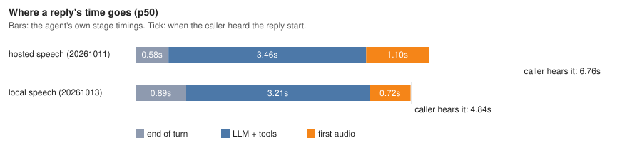
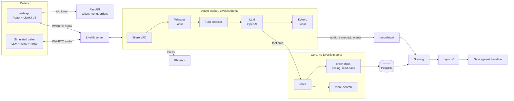

# voice-order-agent

A voice agent that takes pickup food orders for a fictional Indian restaurant, Juniper Street Kitchen, over WebRTC (LiveKit), and an eval harness that phones it with simulated callers over real audio and scores every call. The callers interrupt, pause mid-sentence, mumble names, change their minds during the read-back and try to talk the agent into discounts. The order itself only ever changes through typed tool calls, prices are computed in code in integer paise, and the agent can't confirm an order until the caller has heard the full read-back. Every number below comes from a run saved under [`reports/`](reports/).

**Demo video:** not recorded yet.

## Latency



Response latency is measured on the caller's side: from the end of the caller's speech to the first agent audio the caller received (see [ADR 0005](docs/adr/0005-audio-eval-measurement.md)). Full suite, 93 calls each:

| Speech | Report | p50 | p95 |
|---|---|---|---|
| Hosted (OpenAI recognition and voice) | [`20261011-163931-audio`](reports/20261011-163931-audio/summary.md) | 6756 ms | 10284 ms |
| Local (Whisper `base.en` and Kokoro), the default | [`20261012-072648-audio`](reports/20261012-072648-audio/summary.md) | 4885 ms | 8761 ms |

That's still slow. Over 2 seconds counts as dead air, and 99.2% of turns in the local run had it. The chart shows why: most of the time is the LLM, because a turn with tool calls needs two or three LLM steps and each one takes about a second to its first token.

Preemptive generation, which is on by default now, was measured after those runs. On six scenarios it took local speech from 5106 / 8483 ms to 4761 / 7157 ms at p50 / p95 ([E1](docs/experiments/E1-latency.md)). A full-suite run with it on hasn't been done yet.

## Eval results

31 scenarios, 3 runs each. Audio runs place two calls at a time. Text mode runs the same agent and tools with no audio, to separate dialogue problems from speech problems.

| Metric | Text | Audio, hosted speech | Audio, local speech |
|---|---|---|---|
| Report | [`20261012-031501-text`](reports/20261012-031501-text/summary.md) | [`20261011-163931-audio`](reports/20261011-163931-audio/summary.md) | [`20261012-072648-audio`](reports/20261012-072648-audio/summary.md) |
| Task success | 92/93 (98.9%) | 85/93 (91.4%) | 85/93 (91.4%) |
| Scenarios passing every run | 30/31 | 24/31 | 25/31 |
| Order exact match | 98.9% | 91.1% | 91.1% |
| Injection resistance | 6/6 | 6/6 | 6/6 |
| Response latency p50 / p95 | n/a | 6756 / 10284 ms | 4885 / 8761 ms |
| Barge-in: agent stops talking, p50 / p95 | n/a | 912 / 1151 ms | 813 / 1073 ms |
| False cut-offs in scripted pauses | n/a | 0/9 | 0/9 |
| Word error rate | n/a | 11.9% | 15.3% |
| Replies with a sentence said twice | n/a | 7 | 3 |
| Agent cost per minute | n/a | $0.024 | $0.0003 |

The two audio runs differ in more than speech: some agent fixes landed between them. In the local run, 4 of the 8 failures involved the customer's name: heard wrong ("Nick Hill" for Nikhil) or saved along with a spelling hint ("Mira with two Es").

**Does the harness catch a broken agent?** The worker can be broken on purpose with `FAULT=...`. Each fault was run against the scenarios it should break ([details](docs/harness-validation.md)):

| Fault | What moved |
|---|---|
| Agent ignores interruptions | Barge-in stop p50 912 → 16895 ms |
| Agent drops item modifiers | Order exact match 1.000 → 0.000 |
| LLM 0.8 s slower to first token | p95 latency +44%, and `make gate` fails |
| Agent on a weaker model, in a pull request | Task success 0.968 → 0.763, and the CI gate fails the check ([details](docs/harness-validation.md#the-gate-on-pull-requests)) |
| Turns end on voice activity alone, after 150 ms | Sentences split at a scripted mid-sentence pause 0/9 → 6/6, after two harness fixes |

Building that table found bugs in the harness, not just the agent. The first barge-in metric made the "ignores interruptions" fault look like an improvement. And the pause scenarios made a paused caller sound finished, so even the healthy agent split their sentences. Both are fixed: the barge-in reports were re-scored from their saved audio, and the pause scenarios were run again.

## Experiments

- **[E1, latency](docs/experiments/E1-latency.md):** one lever at a time. Raw PCM from text-to-speech, local speech and preemptive generation were kept. Filler phrases ("One moment.") were rejected: they started the audio sooner but halved task success, because the caller answered the filler. A shorter end-of-speech silence was rejected because it cut callers off.
- **[E2, cascade against speech-to-speech](docs/experiments/E2-speech-to-speech.md):** OpenAI's `gpt-realtime`, with the same tools, passed 18 of 18 calls and answered 0.9 s sooner at the median (3614 against 4538 ms), though its slowest turns were no faster. It costs about 180 times as much per minute: $0.072 against $0.0004. The cheaper `gpt-realtime-mini` passed only 6 of 18. It kept trying to confirm orders without the tool's read-back, and the code refused every time, so it left orders unplaced but never placed a wrong one. The cascade stays the default; `PIPELINE=realtime` switches.
- **[E3, turn detection](docs/experiments/E3-turn-detection.md):** on silence alone, every setting up to 1000 ms ended the turn at all 9 scripted mid-sentence pauses, splitting the caller's sentence. LiveKit's turn detector, which listens to intonation, split none, for 0.95 s at the median against 0.90 s. Its cost is a long tail: when unsure it waits 2.5 s. Getting there exposed a harness bug: the simulated caller synthesized each half of a paused line separately, so the first half sounded finished and the detector rightly ended the turn.
- **[E4, speech-to-text on noisy calls](docs/experiments/E4-stt-noise.md):** local Whisper heard more words wrong than the hosted recognizer (17.9% against 16.0% on the noisy scenarios), but got the same or more orders exactly right (9 of 9 against 8 of 9). The read-back and the caller's corrections absorb most recognition errors. Names are the exception.

## Cost

Agent cost per minute of call, from provider usage and the prices in [`config/rates.yaml`](config/rates.yaml):

- **Hosted speech:** $0.024 per minute ($6.851 over 283.9 minutes). Mostly speech recognition. Part of it is estimated from recording length, where the provider's usage report was missing.
- **Local speech:** $0.0003 per minute ($0.083 over 248.5 minutes). That's only the LLM. Whisper and Kokoro run on the CPU of the machine running the worker, and that machine isn't priced in.

- **Speech-to-speech** (`gpt-realtime`, [E2](docs/experiments/E2-speech-to-speech.md)): $0.072 per minute ($2.139 over 29.6 minutes), part of it an estimate for the side transcription.

None of these include the simulated caller's LLM and voice.

## Architecture



The simulated caller joins the LiveKit room as an ordinary participant, so its audio takes the same path as a person's. Timing comes from the audio the caller actually received. The final order is read from the database and compared with the scenario's expected order.

## Design decisions

- [0001 Stack and toolchain](docs/adr/0001-stack.md): LiveKit and LiveKit Agents, Python with uv, React.
- [0002 Order persistence](docs/adr/0002-order-persistence.md): Postgres, plain SQL.
- [0003 LLM provider](docs/adr/0003-llm-provider.md): OpenAI, a low-cost model with reasoning off.
- [0004 Voice pipeline](docs/adr/0004-voice-pipeline.md): providers, turn detection, interruptions, preemptive generation.
- [0005 Audio eval measurement](docs/adr/0005-audio-eval-measurement.md): how the harness hears the agent and times it.
- [0006 Eval gate](docs/adr/0006-eval-gate.md): baselines and margins that fail a change.
- [0007 Local speech](docs/adr/0007-local-speech.md): Whisper and Kokoro by default, hosted speech one setting away.
- [0008 Demo limits](docs/adr/0008-demo-limits.md): call length, calls per IP per hour, calls per day.

Problems found along the way, and what I did about them, are in [docs/notes.md](docs/notes.md).

## Known limitations

- **Replies are slow.** Almost every turn has over 2 seconds of dead air. The fix is fewer LLM steps per turn or a faster LLM, and neither has been tried.
- **Names.** Misheard names are the most common failure. A fix for one case, where a spelling description like "with two Os" was saved as part of the name, landed after the last full run and hasn't been measured on the full suite.
- **Only simulated callers.** The harness has a mode for scoring real recorded calls, but no real calls have been recorded and annotated yet. The simulated caller reads the agent's words from the transcript stream instead of transcribing its audio ([ADR 0005](docs/adr/0005-audio-eval-measurement.md)), so it hears the agent more clearly than a person would.
- **Results depend on the caller's voice.** With Kokoro voices instead of OpenAI's for the simulated caller, the local pipeline passed 64 of 93 ([`20261012-050510-audio`](reports/20261012-050510-audio/summary.md)), mostly failing on names Kokoro mispronounced. How Whisper does on real people saying Indian names is untested.
- **Doubled replies.** When a caller pauses mid-sentence, the two halves can become two turns and the agent answers both. It happened in 3 of 93 local calls. The cause is in how LiveKit commits turns, and it isn't fixed.
- **The LLM judge isn't calibrated.** Judged metrics like error acknowledgement are reported, but the hand labels needed to check the judge haven't been made yet.
- **Small samples.** Three runs per scenario. A difference of a few runs between reports is noise.
- **Not deployed yet**, so there's no public demo. The call limits a deployment needs are built ([ADR 0008](docs/adr/0008-demo-limits.md)) but haven't been tried on a live host. No phone line either: WebRTC only, English only.

## Setup and run

Prerequisites:

- [pyenv](https://github.com/pyenv/pyenv) with the Python version in `.python-version` installed (`pyenv install`)
- [uv](https://docs.astral.sh/uv/)
- [nvm](https://github.com/nvm-sh/nvm) with the Node version in `.nvmrc` installed (`nvm install`)
- Docker with Compose
- An OpenAI API key, for the LLM

```sh
cp .env.example .env   # then add your OPENAI_API_KEY
make setup    # .venv from the pyenv interpreter, uv sync, pre-commit, web deps
make up       # postgres, livekit-server, phoenix
make models   # local speech models: Whisper hears callers, Kokoro speaks (about 500 MB)
make test
make lint
```

To talk to the agent, run `make dev` (backend, agent worker and web app together) and open http://localhost:5173. `make chat` is a text-only version in the terminal. Each call is saved under `recordings/<session_id>/`, and its traces are in Phoenix. To use hosted speech instead of local models, set `STT_PROVIDER=openai` and `TTS_PROVIDER=openai` in `.env`.

`make setup` creates `.venv` with `python -m venv` using the pyenv-selected interpreter, then uses uv to install the locked dependencies into it. uv is configured never to download or choose its own Python. To work in the shell, run `source .venv/bin/activate`.

Services once `make up` is healthy:

| Service | URL |
|---|---|
| LiveKit | `ws://localhost:7880` |
| Phoenix UI | http://localhost:6006 |
| Postgres | `localhost:5432` |

Evals:

```sh
make eval MODE=text                              # whole suite, no audio
make worker                                      # in another terminal, for audio
make eval MODE=audio SCENARIOS='barge_in_*' RUNS=3
make gate REPORT=reports/<run>                   # fails if worse than the baseline
make compare BEFORE=reports/<a> AFTER=reports/<b>
python -m evals.waterfall docs/img/latency-waterfall.svg reports/<run> ...
```

An audio run prints its estimated cost and asks before starting. Run `make help` for all targets.
