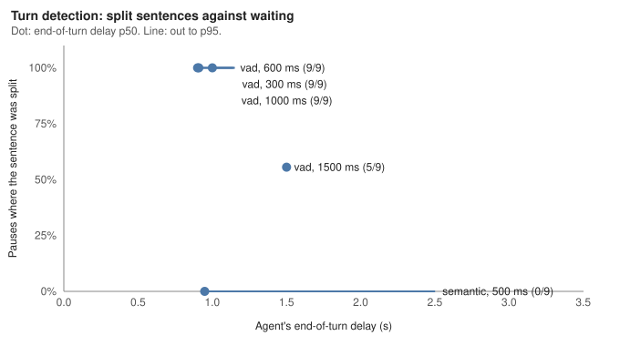

# E3: Turn detection, cut-offs against reply speed

## Setup

- **Question:** how long should the agent wait before deciding the caller has finished? And does LiveKit's turn detector, which also listens for whether a sentence sounds finished, let it answer quickly without cutting off a caller who stops to think mid-sentence?
- **Configurations:**
  - **Semantic, 500 ms:** the default. LiveKit's `turn-detector-v1-mini` runs locally on the caller's audio. If it rates the turn as probably unfinished, the agent waits longer before answering.
  - **Voice detection only, at 300, 600, 1000 and 1500 ms:** the turn ends once the caller has been silent that long, whatever the sentence sounds like.
- **A floor under all of them.** With local Whisper, a turn can't end before voice detection has heard 550 ms of silence and Whisper has transcribed the utterance (`docs/adr/0007-local-speech.md`). Settings below that floor end the turn at the floor.
- **Scenarios:** the three `hesitation_*` scenarios, three runs each. Each run has one scripted mid-sentence pause: 1.2 s while choosing a drink, 1.5 s in the middle of an order, and 1.8 s between the two halves of a phone number. So each configuration has nine pauses.
- **Caller voice:** Kokoro, which costs nothing per line. Kokoro mispronounces Indian names, so task success in these runs mostly reflects names, not turn-taking.
- **The fixed caller.** Until this experiment, the simulated caller synthesized the two halves of a paused line separately, so the first half ended like a finished sentence. These runs use the fix, which speaks the line whole and cuts the pause in (`reports/20261012-pause-prosody`).
- **Metrics:**
  - **Sentences split at the pause:** the agent ended the caller's turn at the pause, before the caller finished the sentence. It comes from the agent's own turn records, lined up with the caller's clock, so it doesn't depend on how fast the reply is. This is the main measure of cutting a caller off. Reports call it "Turn ended during a scripted pause, agent's clock".
  - **False cut-offs,** from the caller's side: agent audio starting before the caller finished. It only sees a cut-off when the reply lands before the caller resumes.
  - **Response latency** p50 and p95 from the caller's side, and the agent's own end-of-turn delay.
  - Task success, with the caveat above.

## Results

| Configuration | Report | Sentences split at the pause | False cut-offs, caller side | End-of-turn delay p50 / p95 (s) | Response latency p50 / p95 (ms) | Task success |
|---|---|---|---|---|---|---|
| Semantic, 500 ms (default) | `20261012-145506-audio` | 0/9 | 0/9 | 0.95 / 2.50 | 4949 / 8687 | 5/9 |
| Voice only, 300 ms | `20261012-150956-audio` | 9/9 | 0/9 | 0.91 / 1.15 | 4799 / 7953 | 6/9 |
| Voice only, 600 ms | `20261012-152411-audio` | 9/9 | 0/9 | 0.90 / 1.14 | 4601 / 7014 | 6/9 |
| Voice only, 1000 ms | `20261012-154112-audio` | 9/9 | 0/9 | 1.00 / 1.15 | 4669 / 6649 | 6/9 |
| Voice only, 1500 ms | `20261012-160005-audio` | 5/9 | 0/9 | 1.50 / 1.50 | 5229 / 7653 | 4/9 |

At 1500 ms, the splits followed the pause lengths: all three 1.8 s pauses in a phone number, two of the three 1.5 s pauses mid-order, and none of the 1.2 s pauses.

Two runs check the measurement itself:

- **Before the caller fix,** the default setting split 6 of 9 pauses in both full baselines (`20261011-163931-audio`, `20261012-072648-audio`), and 6 of 6 in the six-scenario run `20261012-093814-audio`. With the fix, it split none.
- **Voice only at 300 ms, before the fix** (`20261012-140700-audio`), split 9 of 9, the same as after. Silence alone doesn't care how the audio sounds, so the fix shouldn't change it, and it didn't.

## Interpretation

- **Only the turn detector keeps a thinking pause from ending the turn.** With silence alone, every setting up to 1000 ms split every pause, and 1500 ms still split the longer ones. Not splitting a 1.8 s pause on silence alone would mean waiting about 2 seconds after every turn.
- **It costs little at the median.** The default ends a turn in 0.95 s at p50, against 0.90 s for the fastest silence-only setting. The 300 and 600 ms settings come out the same, because local Whisper can't transcribe before voice detection has heard 550 ms of silence, so neither goes below about 0.9 s.
- **Its cost is a long tail.** When the detector rates a turn unfinished, the agent waits 2.5 seconds, and that sets the p95. In this run, the long waits fell on one-word name answers and phone numbers. The offline check found phone numbers rated unfinished even when they were finished (`reports/20261012-pause-prosody`). A shorter maximum wait would trim this tail, at some risk to long pauses. It hasn't been tried.
- **Caller-side latency barely separates the settings.** Its p50 moved between 4601 and 4949 ms across the four fastest settings, which is about the run-to-run variation of the LLM. Only 1500 ms, at 5229 ms, stands out.
- **The caller-side false cut-off metric saw nothing**, 0 of 9 in every run, including the ones that split every sentence. With replies taking about five seconds, the agent's answer never starts before the caller resumes. The split count from the agent's own records is the measure to use.
- **Decision:** keep the turn detector with the 500 ms minimum as the default.

## Limitations

- Nine pauses per configuration, one run each.
- The caller spoke with Kokoro voices, which made task success mostly about names. The detector listens to intonation, and synthetic voices don't hesitate the way people do.
- Scripted pauses are pure silence. Real hesitation often has "umm" in it, which voice detection counts as speech.
- The split count lines up the agent's clock with the caller's to within a few hundred milliseconds, so it allows half a second either side of a pause's start.
- Only the turn detector's minimum wait was varied, not its maximum wait or its threshold.
